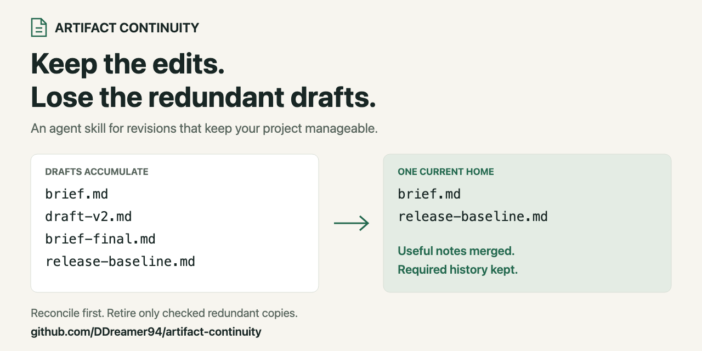
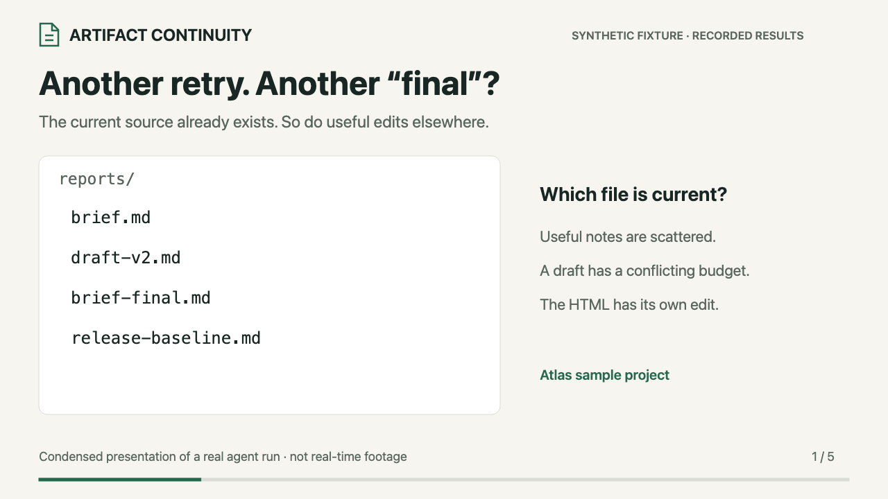

# Artifact Continuity

**Keep improving the work. Keep the tree manageable.**

[](docs/sharing.md)

Artifact Continuity gives AI agents reusable instructions for **keeping revisions reviewable without accumulating redundant files**. An artifact can be a report, project brief, review, knowledge page or generated export. The skill helps the agent update the existing work, merge useful revisions, preserve human edits and required history, and remove redundant working copies after checking them.

For people and teams who iterate on AI-assisted work through **retries, regenerations and versions**: researchers and writers, developers and QA practitioners, and builders of agent or knowledge workflows.

Your next attempt should build on the current file and the right input versions. A new session or retry should not automatically produce another `final-v3` document or dated folder. You invoke the skill through an agent with access to your project files; the agent performs the work using its available tools.

[See the example](#what-a-manageable-tree-looks-like) · [Install and use](#install-and-use) · [40-second demo and sharing kit](docs/sharing.md) · [Validation](docs/validation.md) · [Feedback and contributions](#maintain-and-reuse)

Created and maintained by [DDreamer94](https://github.com/DDreamer94), with AI-assisted development. Its knowledge-maintenance guidance is informed by concepts from [Tencent WeKnora](https://github.com/Tencent/WeKnora). [Credits and provenance →](docs/provenance.md)

## Faster generation makes review more important

**More drafts create more work to review.** When retries leave competing copies, reviewers must also establish which version is current, what changed and where their feedback went. Checking claims, verifying evidence and deciding what to accept still requires attention.

Artifact Continuity guides agents to revise the established document, preserve human edits and approval boundaries, and reconcile redundant working copies. This keeps the current work and the changes awaiting review easier to identify. The project's review and validation process still determines whether the content is correct.

Aim for the **smallest useful set of documents**: one maintained home per distinct deliverable, its needed outputs, and justified history and evidence. Separate observations, required baselines and independently useful documents keep their own identities. A retry alone does not justify another document to compare and maintain.

## What a manageable tree looks like

An ongoing brief has collected two extra drafts:

```text
reports/
  brief.md
  draft-v2.md
  brief-final.md
  release-baseline.md
exports/
  brief.html
```

After an authorized consolidation:

```text
reports/
  brief.md               # Current source, with useful edits reconciled
  release-baseline.md    # Frozen text still needed by a comparison
exports/
  brief.html             # Existing view regenerated from the current source
```

Before removing the two draft copies, the agent merges their useful notes into `brief.md`, resolves conflicting claims and updates links or tools that used the drafts. The HTML is regenerated from that maintained brief. The older baseline stays because a comparison still needs it; original evidence and required source revisions also remain.

Details about which inputs and generator produced the export belong in existing metadata or configuration. Keeping track of revisions should not create another status document or archive folder for every attempt.

This is the [Atlas evaluation fixture](evals/tree-lifecycle.json): its complete project went from 16 files to 14 in both the original and final skill runs, with no writes on repeat. The final run also recorded generation revisions in existing configuration. The point is a clear current home and justified retained history; a lower file count alone does not prove a healthy tree. See the [validation record](docs/validation.md).

<details>
<summary>Watch the 40-second example: preserved edits, fewer redundant drafts</summary>



A condensed presentation of a fresh synthetic run, not real-time footage. [Download the MP4](assets/sharing/demo.mp4) · [Transcript, evidence and sharing copy](docs/sharing.md#demonstration-and-evidence)

</details>

## Does this fit your workflow?

Start with these questions:

- **Do I spend more time sorting competing drafts than reviewing their changes?** Keep the current artifact clear, reconcile useful edits there, and make clear what still needs review.
- **Do I return to the same work across sessions, models or agents?** Find the current source file and continue there.
- **Do retries leave duplicate drafts and make the project tree hard to navigate?** Reconcile useful changes, then retire redundant copies within the authorized scope.
- **Do regenerations leave me unsure which version to use?** Identify the current source and the input versions used to produce its exports.
- **Do reviewer comments, stable IDs or earlier decisions need to survive revisions?** Preserve review history and distinguish old approval from changed content.
- **Do I collect screenshots, traces or results from separate runs?** Keep the runs distinguishable, even when their output files contain identical bytes.
- **Do summaries or indexes become stale when sources change?** Update the affected pages and keep them linked to their sources.

If you recognize one of these patterns, start with **one ongoing artifact and its existing inputs**. A report with reviewer notes, a release handover, or a small knowledge collection is enough.

For a one-off answer with no maintained artifact, there may be little continuity work to do. Scale the process to the task; using this skill does not require a new knowledge system.

### Let your agent help you decide

Paste this into your agent for a short fit assessment:

```text
Help me decide whether artifact-continuity fits my workflow.
Ask one question at a time, up to three, about my current artifact and version,
what gets lost or duplicated during retries, and who relies on the result.
Then recommend whether to use it, the smallest useful starting scope,
and one concrete success check. Keep this assessment conversational;
leave files unchanged.
```

## See it in your own work

These are illustrative situations. The technical handover also has an exercised synthetic fixture; the other examples describe intended use rather than tested customer outcomes.

### Research, writing and recurring reports

An agent regenerates a research brief after a source correction. Continue in `research-brief.md`, retain the review comments, record the corrected source revision, and reconcile the affected overview. Retire a promoted working draft after checking its useful edits reached the maintained brief. Keep any older baseline that a comparison actually requires.

**Useful result:** the next session can find the maintained brief and see which sources it reflects.

### Development, QA and release handovers

An approved amendment changes one rule in a release handover. Revise the existing finding, retain its ID and reviewer comment, mark changed wording for review, and keep two verification runs distinct even when their result files match.

**Try it:** [Lumen's synthetic amendment example](examples/review-amendment.md) and its [validation record](docs/validation.md). The exercise checks document maintenance; it does not verify a real product's behavior.

### Agent and knowledge workflows

An agent regenerates a knowledge export after another source is added. Reconcile the affected topic and overview, record the input set used, and compare any returned edits with the current editing source before promotion.

**Useful result:** a regenerated view has a traceable relationship to its maintained source. The optional [WeKnora pairing](docs/weknora.md) explores this boundary as a proposal.

## What changes in practice?

| Situation | Expected action |
| --- | --- |
| Another session adds findings to the same review | Update its established editing source and existing views. |
| A draft is ready to become maintained work | Compare the baseline, current destination and draft; reconcile human edits. |
| Several drafts represent the same ongoing deliverable | Merge useful changes, repair consumers and retire verified redundant copies within scope. |
| Regeneration fails halfway through | Preserve the last valid output, report it as stale, and clean disposable partial output. |
| A new evidence capture matches an old file's bytes | Keep both when they represent different observation events. |
| An approved amendment adds a source | Refresh the affected topic and overview, preserving scope and unresolved gaps. |
| The same maintenance request runs again with unchanged inputs | Reuse the result and make no unnecessary writes. |

The agent follows your project rules and the scope you authorize. Routine revision does not authorize a project-wide cleanup. This package contains instructions and references; it runs no background service or automatic cleanup job.

## Install and use

### 1. Install once

You need a file-capable agent with access to the project you want to maintain. This skill adds instructions; it requires no separate server, database or API key. Your agent still uses its own account and tools.

For **local Codex**, Git can place the full repository in the user skill directory:

```sh
mkdir -p "$HOME/.agents/skills"
git clone https://github.com/DDreamer94/artifact-continuity.git \
  "$HOME/.agents/skills/artifact-continuity"
```

If that destination already exists, identify its owner and update mechanism first. The clone command refuses a nonempty destination. A managed installation may expose a wrapper pointing to another source; keep using its installer instead of replacing it with a clone.

Codex documents user skill discovery at `~/.agents/skills/`. In the CLI or IDE extension, use `/skills` or type `$` to select a skill; if a new installation does not appear, restart Codex. See the [official skill setup guidance](https://learn.chatgpt.com/docs/build-skills#where-codex-loads-local-skills). The exercises here used Codex; other hosts' installation and invocation behavior have not been verified for this package. For another host, use its documented installer with this repository's root [SKILL.md](SKILL.md) and references.

Alternatively, a **fresh project installation** through the Vercel skills CLI was verified with `skills` 1.7.4. This CLI requires Node.js 22.20 or later. Run from your project:

```sh
DISABLE_TELEMETRY=1 npx --yes --ignore-scripts skills@1.7.4 add \
  DDreamer94/artifact-continuity --skill artifact-continuity --agent codex --yes
```

This installs into the project's `.agents/skills/artifact-continuity` and creates `skills-lock.json`. The check matched every installed file to the public source, including both references and the license. It verified installation, not automatic activation; continue with the check below. If the skill is already installed, identify its owner first: `skills add` replaces its destination. Preserve local customizations and use your existing manager for managed installations. Telemetry is disabled in this command. See the [CLI documentation](https://github.com/vercel-labs/skills/blob/a80e4c9d12d607631249d4d7d059f835d4b2f13a/docs/commands.md).

### 2. Confirm activation

Open your intended project in the agent. In Codex, send this read-only check:

```text
Use $artifact-continuity. Read the installed SKILL.md and report its resolved
path and the two goals it governs. If it is a wrapper, follow its original
source. Leave project files unchanged.
```

Check the actual file-read/tool activity and resolved path. The two goals are preserving changes correctly and keeping the project tree manageable. This confirms the instructions were loaded; the walkthrough below checks how they are applied.

### 3. Try a contained example

Follow the [runnable Lumen walkthrough](examples/review-amendment.md#try-it-in-a-temporary-project): copy the supplied sample into a temporary project, apply an approved amendment, inspect the preserved notes and evidence, then repeat the request and compare hashes and modification times. It uses Python 3's standard library and the existing fixtures. The fixture itself needs no external service.

The walkthrough needs a full repository checkout containing `evals/`. If your installer supplied only the core skill files, download a separate reference checkout to an ordinary working directory. Keep it outside the host's skill discovery directories so it does not become a second installation.

### 4. Apply it to ongoing work

Start with one named artifact and its dependent outputs. Replace the example paths and supply the actual approved changes:

```text
Use $artifact-continuity to apply these approved changes to reports/brief.md
and its affected exports. Preserve human notes and required history.
Check the current inputs and outputs; reuse valid unchanged results.
Report the current entrypoints, changes made and unresolved gaps.
```

When you also want consolidation, specify the draft folder and authorize retiring redundant copies after reconciliation. An ordinary edit remains scoped to that edit and its dependents.

For projects that should apply continuity consistently, merge this short rule into their existing agent instructions, such as `AGENTS.md` in Codex:

```text
For maintained artifact creation, revision, import or regeneration, use the
installed artifact-continuity skill. Reuse the established editing source;
preserve human changes and required history. Check affected dependencies,
reuse valid unchanged outputs, and consolidate only within authorized scope.
If the skill is unavailable, report that gap.
```

Keep the shared skill at its installed location. The project rule supplies a trigger; it does not install the skill, grant file access or provide automatic enforcement.

### Keep routine work small

The agent should reuse an owner and dependency map already confirmed in the task, read relevant sources, update affected outputs and stop when the scoped checks pass. An unchanged valid result should cause no generation or file writes. A changed output, missing baseline or unresolved source gap still needs inspection. There is no measured speed or token-saving claim; the [validation record](docs/validation.md) reports observed preservation and repeat-write behavior.

### Troubleshooting and updates

| Symptom | Next check |
| --- | --- |
| The skill is missing | Check the host's discovery path and that it contains `artifact-continuity/SKILL.md`; reload the host and repeat the activation check. |
| Multiple versions appear | Resolve each path and its installation owner. Use one intended version for the task and reconcile duplicate installations through their owners. |
| The agent says it is using the skill but creates another revision copy | Inspect its file-read activity, artifact ownership decision and the [worked example](examples/review-amendment.md). Check whether the new file has a distinct purpose. |
| Files cannot be read or written | Grant the host the intended project access. Installing a skill does not change its permissions. |
| A generated result is stale or blocked | Keep the last valid output, identify the changed input or missing dependency, and resume when it is resolved. |

For a Git clone, inspect `git status` and the remote before updating. Fetch upstream, review the change from the installed commit, and fast-forward a clean tracking branch or select a reviewed commit. Preserve local edits. For a managed installation, use its update mechanism. Then repeat activation and the relevant example; an agent that already read older instructions should reload them. Record the installed revision through existing Git history or the manager's receipt.

## How it can pair with WeKnora

Artifact Continuity guides identity, authority and reconciliation decisions. WeKnora can provide a knowledge platform for ingestion, retrieval and Wiki generation.

The [proposed pairing guide](docs/weknora.md) describes keeping project files as the editing source, publishing selected knowledge, tracking source identities and revisions, and reconciling returned edits against the current baseline.

**Status:** architectural proposal. No connector or live integration has been implemented or tested. WeKnora is optional, and this is an independently maintained project.

## What's inside?

```text
SKILL.md                              Agent entrypoint and continuity workflow
references/workspace-layout.md        Ownership, retries, retention and promotion
references/knowledge-maintenance.md   Layers, freshness and reconciliation
agents/openai.yaml                    Optional Codex UI metadata
examples/                            Worked scenario
evals/                               Synthetic fixture and inspection criteria
docs/                                Provenance, validation, pairing and sharing guide
assets/sharing/                      Editable share card and captioned demo exports
```

The [validation notes](docs/validation.md) distinguish the initial amendment exercise from the tree-management and failed-regeneration review. These are small synthetic filesystem scenarios, with actual artifacts and repeat-write checks. They do not establish performance, automatic discovery or reliability across every agent host.

## Maintain and reuse

[Report a workflow problem or suggest an improvement](https://github.com/DDreamer94/artifact-continuity/issues). Include your agent/host, the installed skill revision, a small example of the files involved, and the expected versus actual result. Explain which edits, history or evidence needed to survive. Use a sanitized example that can be shared publicly.

Contributions to the instructions, examples and evaluation scenarios are welcome. A useful change shows how the agent handles a revision more correctly or keeps the tree easier to navigate, and checks that required content is preserved.

Keep portable instructions in `SKILL.md`, `references/` and `agents/`. Leave host paths and private project policies in their owning environments. When changing behavior, exercise the [evaluation scenario](evals/README.md) and inspect actual files and meaning; structural validation alone is insufficient.

This repository is the standalone editing source going forward. Downstream bundles should consume pinned revisions. Publishing it does not automatically replace an existing managed installation.

## License and credits

[MIT License](LICENSE), copyright 2026 DDreamer94.

WeKnora is acknowledged for conceptual influence on knowledge organization, identity reuse, freshness and quality checks. Its implementation files are not distributed here. The [provenance record](docs/provenance.md) links the reviewed revision and explains the attribution boundary.
